# Exo Player

**A video player made for the AYN Thor's two screens.** The film plays on the top screen with nothing over it; everything you touch lives on the bottom screen. It plays movies, series and anime from your SD card, fetches posters and plots when you ask, remembers where you stopped, plays the next episode for you, and aims to use no more battery than VLC.

<p align="center">
  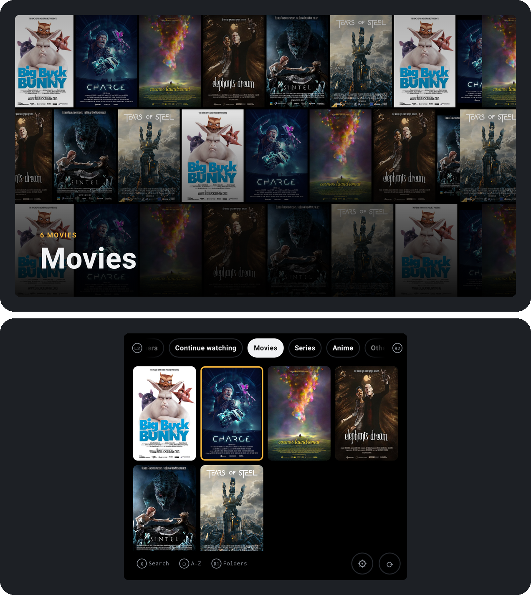
</p>

> **v1.0.0.** Every v1 feature is built and its 77 tests pass on a PC, with both screens drawn at the Thor's real sizes. It hasn't run on a Thor yet: the two v1 gates (testing on the device, and a battery test against VLC) are next. The online parts were tested against stand-in servers, since the build machine couldn't reach the real services. Personal app, installed as an APK; not on the Play Store.

## How the two screens are used

| | Top screen (6″, 1920×1080) | Bottom screen (3.92″, 1240×1080, touch) |
| --- | --- | --- |
| **Browsing** | A mix of the tab's posters, or the focused title's art and plot | Five tabs on L2 / R2, poster cards, Search, Fetch info, Settings |
| **Watching** | The film and its subtitles, nothing else. Paused: the title's art | Progress, Pause, volume, audio, subtitles and their timing, ‹ Prev / Next › |
| **Series** | The show, then the season, then the focused episode | Season cards, then episode cards with ✓ watched and progress |

The top screen never takes input; the controller and touch work on the bottom screen. Turn the bottom screen off with ⏻ and the film keeps going; with no bottom screen at all, its controls slide in from the right on the top screen.

<p align="center">
  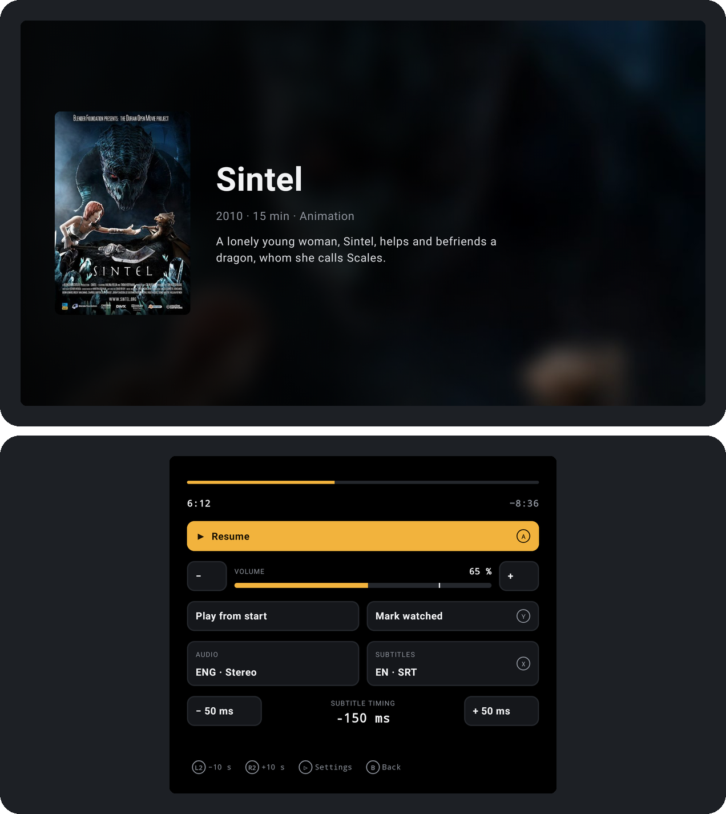
  &nbsp;
  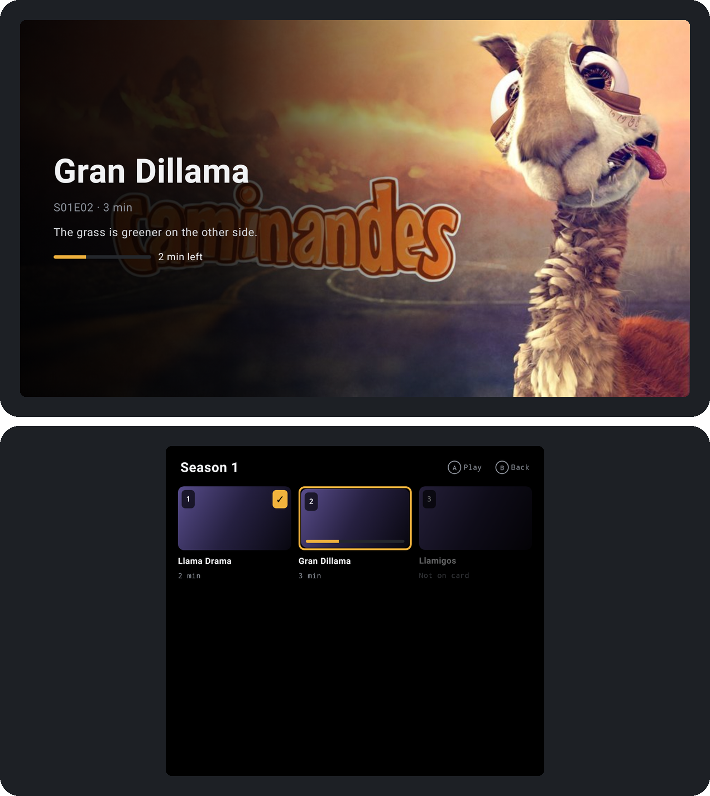
</p>

## What it does

**Library**
- Pick your video folder once (SD card or internal). It finds every video, loose or in Show / Season folders, and reads names like `The.Dark.Knight.2008.1080p.mkv`, `Breaking.Bad.S02E05.mkv` and `[SubsPlease] Frieren - 12.mkv`.
- Five tabs: **Continue watching**, **Movies**, **Series**, **Anime**, **Others**. Search (X), sort and filter (Select: A–Z, Recently added, Year, Unwatched only), and a folder browser (R1).
- **⟳ Fetch info** fills in posters, backdrops, plots, seasons and episodes from TMDB, with fanart.tv and AniList as fallbacks. It fetches only what's missing, and keeps going if you leave the app, with a progress notification.
- **✎ Fix match** when a title is wrong: search by name or type its TMDB ID. The fix survives rescans.

**Watching**
- Opens where you stopped; saved on pause, on leaving and once a minute; watched at 90 %.
- **Up next** with a 10-second countdown at the end of an episode.
- L2 / R2 skip 10 seconds; tap or drag the progress bar to jump.
- Audio and subtitle tracks; subtitle timing in 50 ms steps, earlier or later.
- **Find subtitles** from OpenSubtitles when a video has none, saved next to the video.
- **Playback settings** (Start): speed, picture (Fit, Zoom, 16:9, 4:3, Stretch), audio delay, subtitle size, position and background, top screen brightness.
- Volume bar with a boost to 200 %; the Thor's volume buttons move it without Android's pop-up over the picture.
- Hardware decoding first; FFmpeg audio for DTS, TrueHD and AC3.

**Battery and privacy**
- Online only when you press ⟳, ✎ or Find subtitles. Nothing runs in the background except a Fetch info you started.
- Leaving the app pauses the film and frees its decoders. True black everywhere; the bottom screen redraws once a second during a film and dims after 10 seconds.
- API keys and your OpenSubtitles login are stored encrypted on the device only.

## Screens

<table>
  <tr>
    <td width="50%">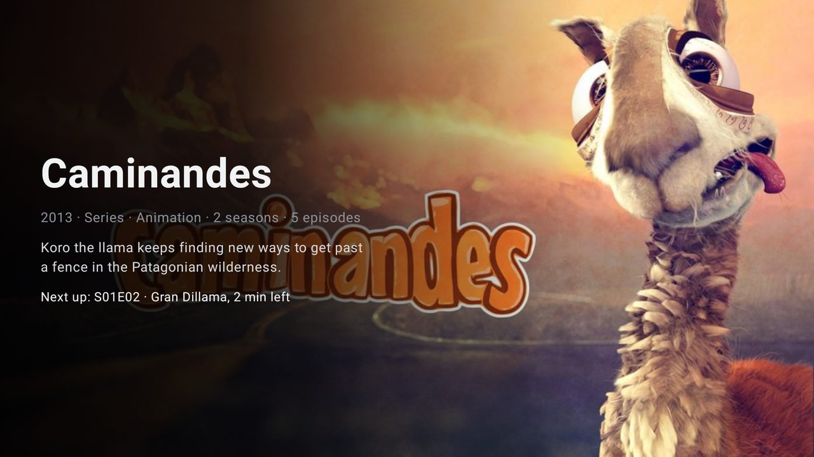<br><sub>A series: its art, details and the episode to continue</sub></td>
    <td width="50%">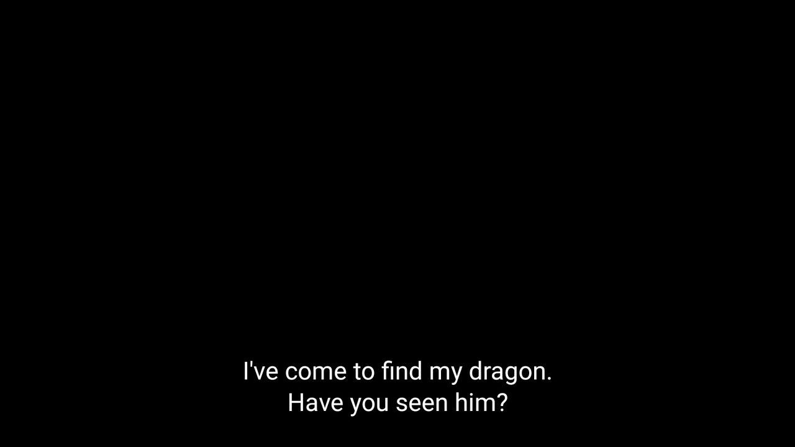<br><sub>Watching: only the film and its subtitles</sub></td>
  </tr>
</table>

<table>
  <tr>
    <td width="33%">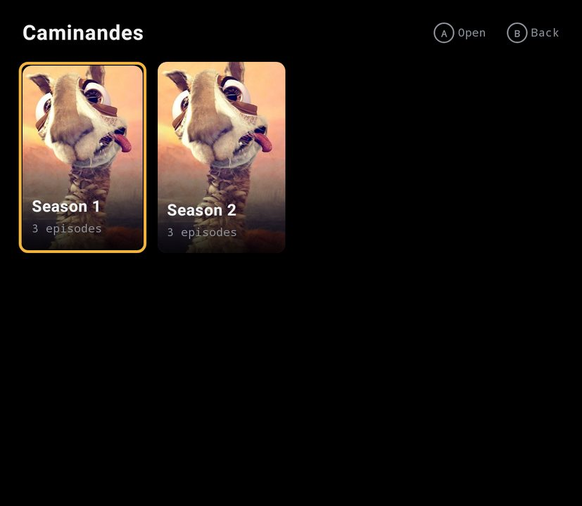<br><sub>Season cards</sub></td>
    <td width="33%">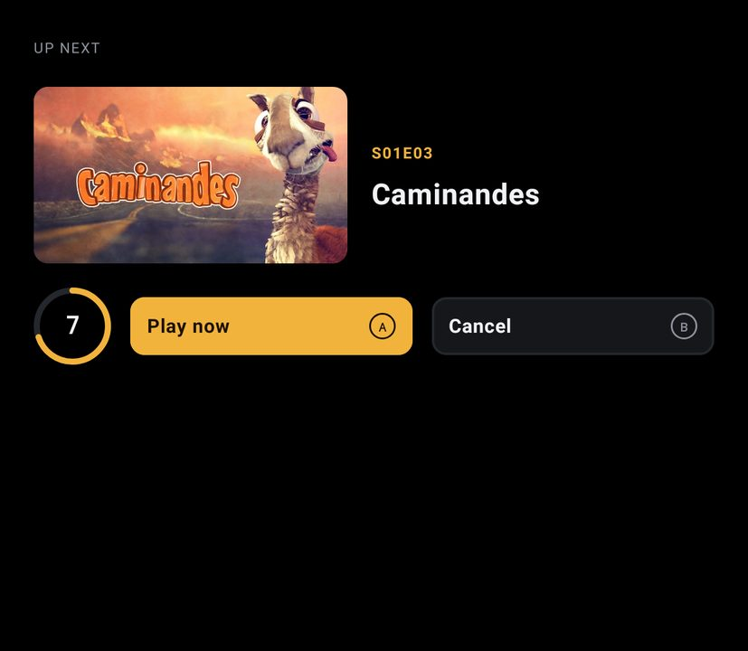<br><sub>Up next, 10 seconds</sub></td>
    <td width="33%">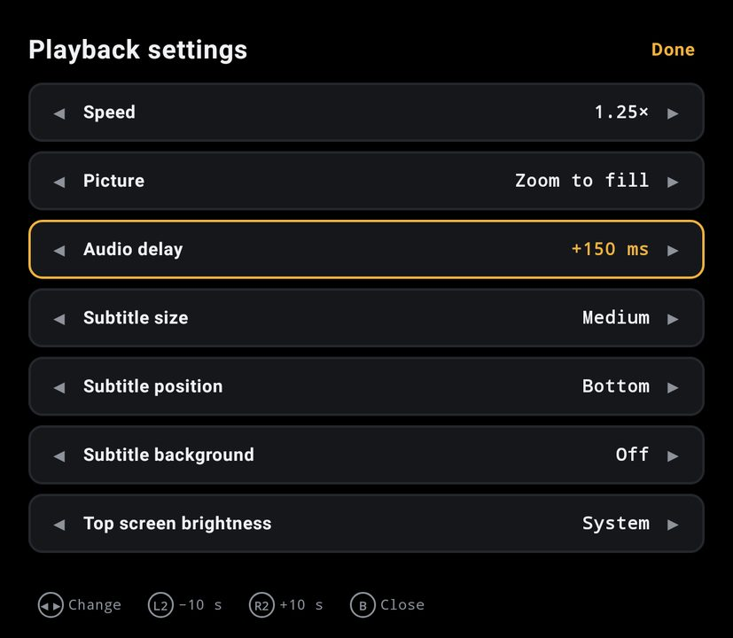<br><sub>Playback settings (Start)</sub></td>
  </tr>
  <tr>
    <td>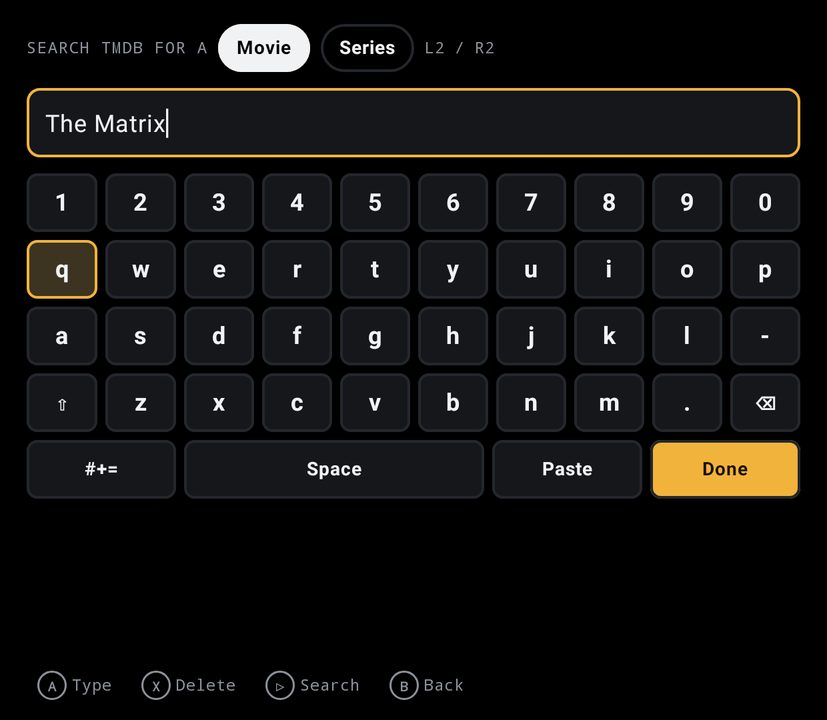<br><sub>✎ Fix match, on the app's own keyboard</sub></td>
    <td>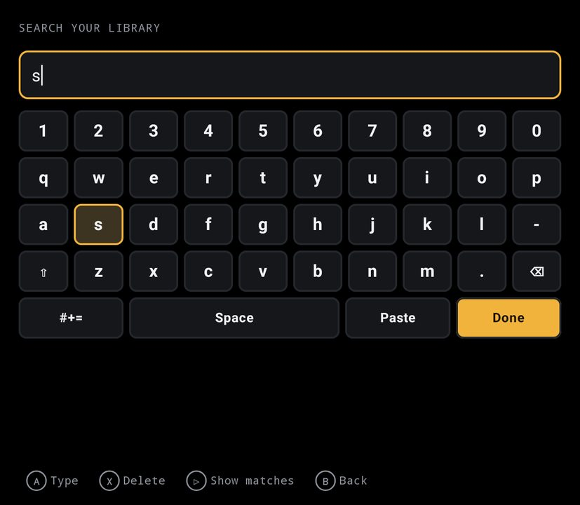<br><sub>Search (X)</sub></td>
    <td>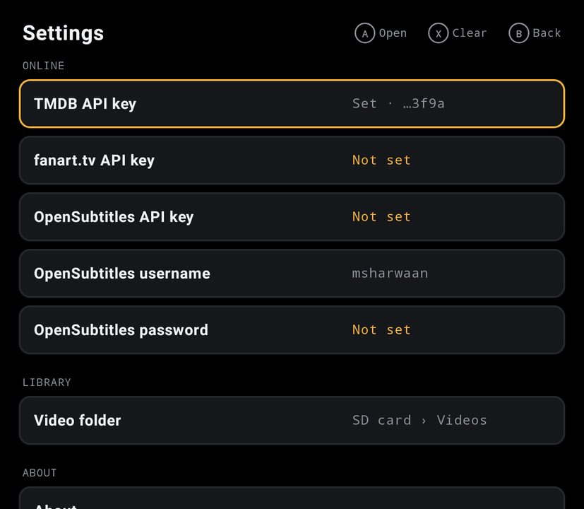<br><sub>Settings: keys, refresh rates, folder</sub></td>
  </tr>
</table>

These are drawn by the app's own code at the Thor's pixel sizes, from its screenshot tests, using the Blender Foundation's open films as sample content. Every screen state is also on the [mockup page](https://claude.ai/artifact/JKHKE3bY5DPKwPxaqQdjhr).

## Buttons

| Button | Browsing | Watching |
| --- | --- | --- |
| **A** | Focus, then open | Press the focused button (Pause / Resume to start with) |
| **B** | One step back | Stop, save and go back |
| **L2 / R2** | Previous / next tab | Back / forward 10 s |
| **D-pad** | Move through the cards | Move between the buttons |
| **X** | Search | Next subtitle track |
| **Y** | ✎ Fix match on the focused card | Mark watched / unwatched |
| **Start** | Settings | Playback settings |
| **Select** | Change the order | — |
| **R1** | Folder browser | — |
| **Select + Start** | The diagnostics page that measures the Thor | |

## Getting started

1. **Build the APK** (needs JDK 17+ and the Android SDK, platform 36; put `sdk.dir=…` in `local.properties`):
   ```
   ./gradlew assembleDebug        # app/build/outputs/apk/debug/app-debug.apk
   ./gradlew testDebugUnitTest    # 77 tests; screenshots of both screens in app/build/screenshots
   ```
2. **Install it on the Thor** with USB debugging on (`adb install app-debug.apk`), or copy the APK over and open it.
3. **Pick your video folder** when the app asks.
4. **Add your keys in Settings** (Start, or ⚙ on Browsing). Type them on the app's keyboard, or copy them in the browser and press Paste:
   - TMDB API key, free: themoviedb.org › Settings › API (needed for Fetch info and Fix match)
   - fanart.tv personal key (optional)
   - OpenSubtitles API key, username and password (for Find subtitles; logged in, about 20 downloads a day)
5. **Press ⟳** on a tab to fetch its posters and info.

## How it's built

- **Kotlin and Jetpack Compose**; **Media3 ExoPlayer** with Jellyfin's FFmpeg audio decoders; **Room** for the library; **OkHttp** for the online parts.
- **Two screens through Android's `Presentation` API**: the activity and the film on the top screen, a non-focusable Compose window on the bottom screen, the approach melonDS, Azahar and Loki use on the Thor. Video in a `SurfaceView`, the cheapest way to show it.
- **Public Android APIs only**: no root and no AYN system service. The app asks only for internet, network state, notifications (for Fetch info's progress) and a foreground service while Fetch info runs.

## Roadmap

| Version | What it adds | Status |
| --- | --- | --- |
| v0 | Two-screen test app that measures the Thor; layout mockups | Built (Select + Start); measurements need the Thor |
| **v1** | Library, artwork, resume, Continue watching, Up next, subtitles, search, the player extras | **Built** · gates need the Thor |
| v2 | Background audio, full ASS subtitle styling, backup, launch from frontends, TV output | Planned |
| v3 | Skip intro, Trakt sync, themes, picture-in-picture | Planned |

**Not in v1, on purpose:** MKV chapter jumps (ExoPlayer doesn't read them), a touch lock (⏻ already turns the only touch screen off), and notification controls (they come with background audio).

## Documents

| Document | What's in it |
| --- | --- |
| [docs/PLAN.md](docs/PLAN.md) | The plan and all 48 decisions: how the Thor works, the two-screen design, battery rules, architecture, data model, testing, risks |
| [docs/FEATURES.md](docs/FEATURES.md) | Every feature with its version and acceptance test |
| [Mockup page](https://claude.ai/artifact/JKHKE3bY5DPKwPxaqQdjhr) ([source](docs/mockups/plan-and-screens.html)) | Both screens in every state, the plan with what's built, a comparison with VLC, MX Player, Just Player, Kodi, mpv and Nova, the layout rules, and the real screenshots |
| [docs/research/thor-dual-screen.md](docs/research/thor-dual-screen.md) | How the Thor's two screens work, and how melonDS, Azahar, Loki, Wayfinder and ES-DE drive them |
| [docs/research/thor-platform-and-issues.md](docs/research/thor-platform-and-issues.md) | What AYN publishes, firmware history, and issues other Thor developers hit |

## Credits and licence

Artwork and metadata come from [TMDB](https://www.themoviedb.org/), [fanart.tv](https://fanart.tv/) and [AniList](https://anilist.co/); subtitles from [OpenSubtitles](https://www.opensubtitles.com/). This product uses the TMDB API but is not endorsed or certified by TMDB. Sample artwork in the screenshots is from the Blender Foundation's open films (CC BY; see [docs/mockups/art/CREDITS.md](docs/mockups/art/CREDITS.md)).

Licensed under the [GNU GPL v3](LICENSE).
